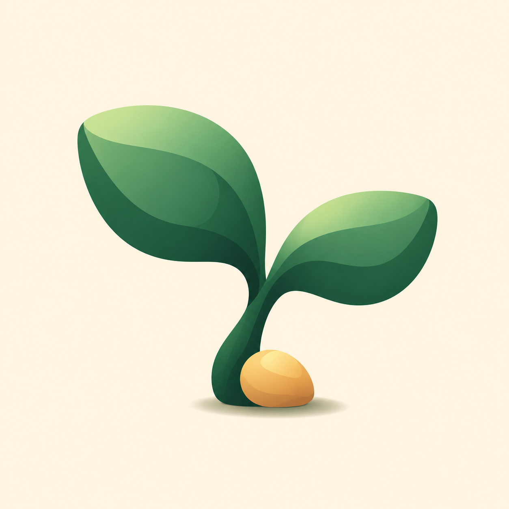

# Restling

**A little rest. A little growth.**

A gentle macOS menu bar reminder that turns short eye breaks into a growing pixel forest. 默认每用眼 **20 分钟**，提醒抬头看远处 **20 秒**。应用界面目前为中文。



## Install

Requires **macOS 13 or later**. The universal app supports Apple silicon and Intel Macs.

```sh
brew install --cask yuki-uix/restling/restling
```

Open **Restling** from Applications. It lives in the menu bar; closing its main window keeps reminders running. Choose “开启休息提醒” to start.

You can also download the app from [GitHub Releases](https://github.com/yuki-uix/restling/releases).

**Community preview:** the current release uses a local ad-hoc signature and has not been notarized by Apple. macOS may block its first launch. After attempting to open it, go to **System Settings → Privacy & Security → Open Anyway** if macOS offers that option, and confirm the app you downloaded. See [Apple’s instructions](https://support.apple.com/en-us/102445). Homebrew installation does not remove this first-launch requirement.

## Your rest forest

- Start with bare earth. The first completed break brings a sprout, the second a sapling, and the third a lasting tree and more land.
- Unlock pine and blossom trees after 3 and 6 completed breaks. Every 3 breaks adds another tree; full groves make room for new ones.
- Browse the tree catalogue and choose which unlocked species to grow. Existing trees stay as they are.
- Enjoy sunlight, moving clouds, breeze and rain. Weather changes the atmosphere, not your progress; Reduce Motion freezes animation.
- Rest behind a native frosted-glass overlay. There is nothing to feed or collect during the break. Press Esc to leave early; your existing forest stays safe.
- Keep separate local forest profiles. Previewing or skipping a break does not earn growth.

The default rhythm is adjustable. This is a rest companion, with no streak penalty or withering trees.

## Reminders that fit your day

Open **“提醒设置…”** from the menu bar or the settings button in the main window. Rhythm and reminder choices stay as a draft until you save; cancelling leaves them unchanged.

- **A gentle heads-up:** by default, a small non-activating panel appears 10 seconds before a break. Choose 10, 20 or 30 seconds, or turn it off. During the heads-up or a full-screen break, choose **3 or 5 minutes later**; a later choice replaces the pending deadline and earns no forest growth.
- **Working days and hours:** optionally restrict reminders to selected weekdays and local start/end times. A Friday 22:00–06:00 window belongs to Friday and continues into Saturday morning. Equal start/end times mean the whole selected day. Outside the window there is no break overlay or reminder sound; the next eligible window starts a fresh use interval.
- **Temporary do-not-disturb:** choose **30 minutes or 1 hour** from the menu bar, or end it early. The menu shows the reason and recovery time. Reminders resume only when the other restrictions also allow them; a manual pause stays paused.
- **Away and return:** no-input detection is enabled by default after 5 minutes and can be disabled or adjusted. Locking the Mac or meeting the idle threshold cancels the pending break and restarts the use interval. Returning adds a configurable grace period, 30 seconds by default. Keeping still during an active break does not itself interrupt that break.
- **Separate sound controls:** start and end cues can be turned off independently. Previews are silent; blocked reminders do not play either cue. The end cue lets you finish a break without watching its countdown.

System sleep and display sleep freeze the current timer rather than count time away. On return, the grace period applies before a previously running timer continues; a simultaneous lock or idle condition follows the fresh-interval rule above. A snooze that expires during sleep or a long app stall is discarded and a fresh use interval begins; a future snooze deadline survives sleep. Relaunching restores the saved running/paused intention and remaining time, then applies current schedule and presence restrictions. Offline time is not replayed or converted into extra rests or trees.

**Launch at login is off until you enable it.** Its control applies immediately through macOS; it is separate from the sheet's Save/Cancel buttons. If approval is required, use the button to open the system's Login Items settings. Closing the sheet does not undo a login-item change already made.

Changing the 20/20 rhythm restarts the current timer and preserves your existing forest. Reminder preferences, temporary pause deadlines and the saved timer stay on this Mac. No camera or gaze verification is involved; a completed rest means the app's rest timer finished.

## Updates

Restling checks its [public release feed](https://github.com/yuki-uix/restling/releases/latest/download/update.json) at most once every 24 hours automatically. You can disable automatic checks or choose “检查更新” in the app or menu bar at any time.

When an update is available, Restling shows release notes and a command you can copy. It does not download or install app updates itself.

```sh
brew update
brew upgrade --cask yuki-uix/restling/restling
```

## Local data and privacy

Forests, settings and update preferences stay on your Mac. There are no accounts, ads, analytics or cloud sync. The frosted overlay uses native macOS material and needs no screen recording permission. Update checks contact GitHub without sending forest data. See [PRIVACY.md](PRIVACY.md).

The bundle identifier remains `local.yuki.breaktime` so existing local forests from 小憩 are retained. Quit the earlier app before running Restling to avoid duplicate reminders.

## Roadmap

Feature planning and progress live in [Restling Projects](https://github.com/users/yuki-uix/projects/6/views/4) (sign in as `yuki-uix` to view the private project):

- [Epic overview](https://github.com/users/yuki-uix/projects/6/views/8): five product goals with native sub-issue progress.
- [Features by Epic](https://github.com/users/yuki-uix/projects/6/views/9): reminder experience (#1–#6), records and data protection (#7–#8), long-term forest ecology (#9–#10), cross-device companionship (#11), and trusted distribution (#12).
- [Feature board](https://github.com/users/yuki-uix/projects/6/views/4): backlog → ready → in progress → validation → done.
- [Feature schedule](https://github.com/users/yuki-uix/projects/6/views/5): Now / Next / Later / Parked / Shipped.
- [Iteration board](https://github.com/users/yuki-uix/projects/6/views/6): agreed Now work, with issue state showing whether each item is queued, in progress or complete. The v0.9 reminder scope is tracked by [Epic #17](https://github.com/yuki-uix/restling/issues/17) and its six feature issues.
- [Version plan](https://github.com/users/yuki-uix/projects/6/views/7) and public [milestones](https://github.com/yuki-uix/restling/milestones): v0.9 for everyday reminders, then v0.10 for long-term forest growth and data foundations.

Each issue includes acceptance criteria and dependencies. Now selects the next work; it does not mean implementation has started. Plan by version and sequence, then agree dates when an iteration starts. Move one item at a time into implementation and validation. Developer ID signing and notarization remain [parked #12](https://github.com/yuki-uix/restling/issues/12) until the developer membership and certificate are ready.

Epics track product outcomes across versions; milestones stay on feature issues. Existing feature views exclude parent Epics so execution cards are not duplicated. Sub-issue progress covers the currently defined tasks; review each Epic's overall acceptance criteria before closing it. Cross-device scope research alone does not mean cross-device features have shipped. The four v0.8.0 baseline cards remain separate historical records.

## Build

Use macOS with Xcode Command Line Tools and a compatible Swift toolchain.

```sh
swift test
./scripts/build-app.sh --universal
open dist/Restling.app
```

To build and copy the app into your user Applications folder:

```sh
./scripts/build-app.sh --install
open "$HOME/Applications/Restling.app"
```

The app is built with SwiftUI and AppKit. Forest scenes and trees are drawn by project code; the Restling icon was designed with built-in image generation and compiled into platform icon assets with AppKit. This distribution contains no Forest or 1Break code or branding, and no earlier experimental cat videos.

Release packaging and Homebrew maintenance are documented in [RELEASING.md](RELEASING.md).
